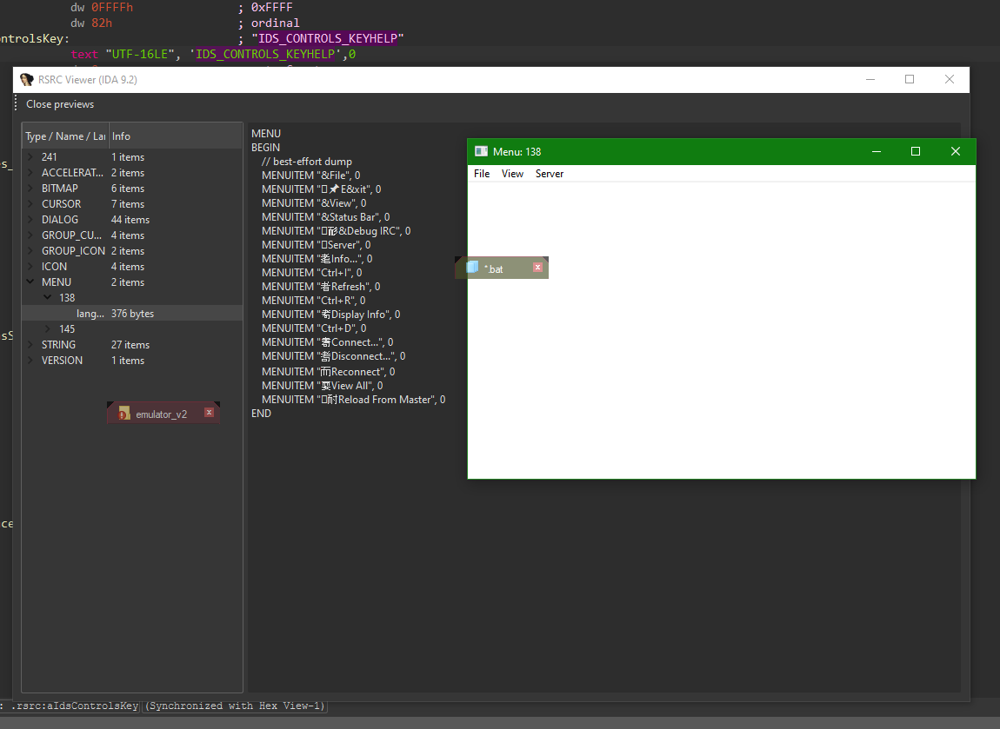
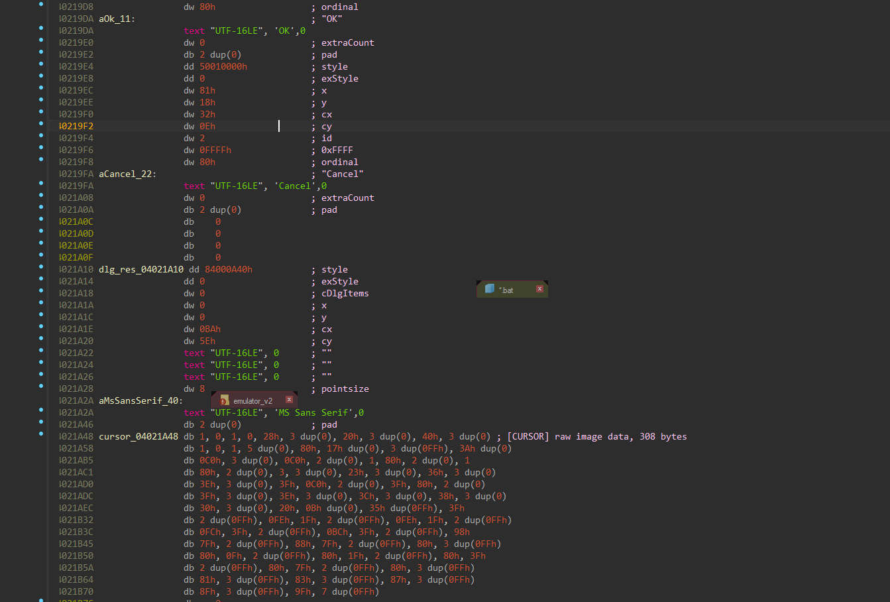
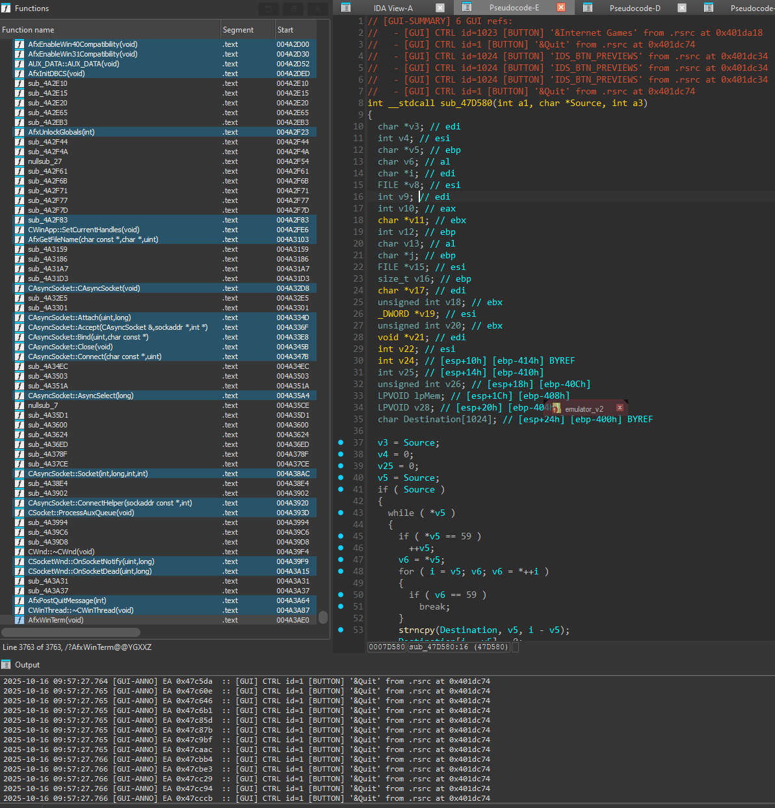
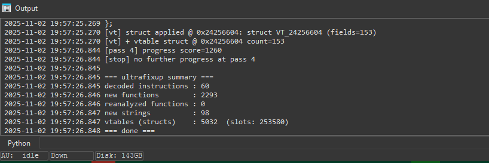

***NOTE: This is still VERY WIP!  Feel free to put in Pull requests if you fix, improve or add something!***

# IDA Resource Tools

This repository contains two complementary IDA Pro 9.2 scripts for working with the `.rsrc` section of Windows PE binaries.  
Together, they allow both **formatting and visualization** of Windows resources directly inside IDA.

> Can be run as either a Python script within IDA or as a plugin.

---

## 🔎 Previews

  
  &nbsp;&nbsp;&nbsp;
  
  &nbsp;&nbsp;&nbsp;
  
  &nbsp;&nbsp;&nbsp;
  

- Click either thumbnail to open the full-size image.

---

## 🧠 Scripts Overview

### `format_rsrc.py`
An **IDA in-database formatter** that dissects and annotates the `.rsrc` section in PE files.  
It identifies resource directories, names, and data entries, applying type-aware parsing for common resource types such as dialogs, menus, icons, cursors, and version information.

**Key features**
- Walks the `.rsrc` tree recursively and adds structure names and comments.  
- Recognizes standard resource types (`DIALOG`, `MENU`, `STRING`, `VERSION`, `ICON`, etc.).  
- Creates IDA string literals, defines words/dwords, and sets readable labels for each entry.  
- Annotates version info blocks, dialog templates, and accelerator tables.  
- Requires no external dependencies—runs entirely inside IDA using its native modules (`ida_bytes`, `ida_segment`, `ida_kernwin`, etc.).

---

### `resource_viewer.py`
A **PySide6-based resource browser and previewer**.  
It scans the parsed `.rsrc` section and displays a navigable tree of resource entries, allowing interactive previews of embedded icons, cursors, bitmaps, dialogs, and menus.

**Key features**
- PySide6 GUI for interactive viewing.  
- Previews icons and cursors (legacy monochrome and PNG/DIB formats).  
- Displays dialogs and menus using live Win32 previews.  
- Decodes version info, accelerators, and string tables.  
- Integrates with IDA logging and runs as script or plugin (`run()` entry point).  
- Depends on `PySide6` and optionally `Pillow` for image handling.

---

### `gui_annotation.py`
An **IDA 9.2 plugin and script** that automatically scans Windows GUI binaries and annotates assembly and pseudocode with context-aware comments for dialogs, controls, and message-handling routines.  
It bridges `.rsrc` parsing with code analysis to reveal how GUI components connect to functions and message maps.

**Key features**
- Automatically locates and indexes controls, menus, and dialog resources from `.rsrc`.  
- Adds comments for `WM_*` messages, `IDS_*` strings, and GUI-related API calls (`CreateDialogParam`, `SendMessage`, etc.).  
- Identifies MFC and ATL message handlers (`OnCommand`, `OnNotify`, etc.) and annotates their references.  
- Supports both x86 and x64 binaries and uses backtracking to resolve register and stack-based arguments.  
- Integrates with Hex-Rays to show GUI comments inline in pseudocode when available.  
- Can be run as an **IDA plugin** or a **stand-alone script**, requiring no external dependencies.  
- Designed for performance and readability, enhancing disassembly clarity when reverse engineering GUI-heavy Windows binaries.

---

### `ultrafixup_second_pass.py`
An **IDA 9.2 second-pass auto-analysis enhancer** designed to deepen and repair initial program analysis.  
It identifies missing functions, decodes previously unknown code regions, recovers overlooked strings, and generates structured vtable types for cleaner and more meaningful reverse-engineering output.

**Key features**
- Iteratively expands undefined executable areas into valid instructions.  
- Detects prolog-based and linear-flow functions and automatically creates them.  
- Reanalyzes discovered functions to stabilize stack, prolog, and flow metadata.  
- Locates and defines missed ASCII and UTF-16 string literals.  
- Finds contiguous virtual function pointer tables and generates proper struct types.  
- Applies vtable structures and names function pointers for improved clarity.  
- Executes multiple passes until no further analysis progress is detected.  
- Operates entirely within IDA using official 9.2 APIs; no external dependencies.  

---

### `mfc_afx_rebuilder_ida92_fast_rtti_mfc.py`
A **high-performance MFC/AFX vtable and instance rebuilder** for IDA 9.2.  
It performs block-level vtable discovery, resolves MSVC RTTI names, correlates MFC `CRuntimeClass` metadata, defines vtable structs, types object instances, and annotates `.rsrc`-based resource IDs and operands.

**Key features**
- Fast block-scan detection of vtables in `.rdata` / `.data` segments.  
- Confirms vtable heads via live executable range checks and function validation.  
- Builds and injects struct types for vtables & object instances with batch Local Types.  
- Recovers class names using MSVC RTTI; maps to MFC `CRuntimeClass` when present.  
- Finds and types vptr instances across data segments and reloc/xref tables.  
- Adds comments & operand offsets for `.rsrc` resource IDs (`IDC`/`IDD`/`IDR` etc.).  
- Optional Hex-Rays integration to name virtual functions by decompilation.  
- Caches processed vtables to avoid reprocessing in future sessions.  
- Optimized for large GUI executables (including legacy MFC apps).  

---

## ⚙️ Installation

**Requirements**

Each script includes its own `requirements.txt`  
- `format_rsrc.py` → no external dependencies  
- `resource_viewer.py` → requires `PySide6` and `Pillow`

Install them with IDA’s bundled Python:

    python -m pip install -r requirements.txt

**Plugin setup (optional)**  
1. Place the scripts in IDA’s `plugins/` directory.  
2. Restart IDA—the plugin appears in the Plugins menu.

---

## 🧩 Example Workflow
1. Run `format_rsrc.py` in IDA to annotate the `.rsrc` tree.  
2. Launch `resource_viewer.py` to browse and preview icons, dialogs, and other resource items.

---

## 📄 License
Use freely at your own risk. These scripts interact directly with PE resource structures inside IDA; quirks with malformed binaries or odd encodings are your problem.

